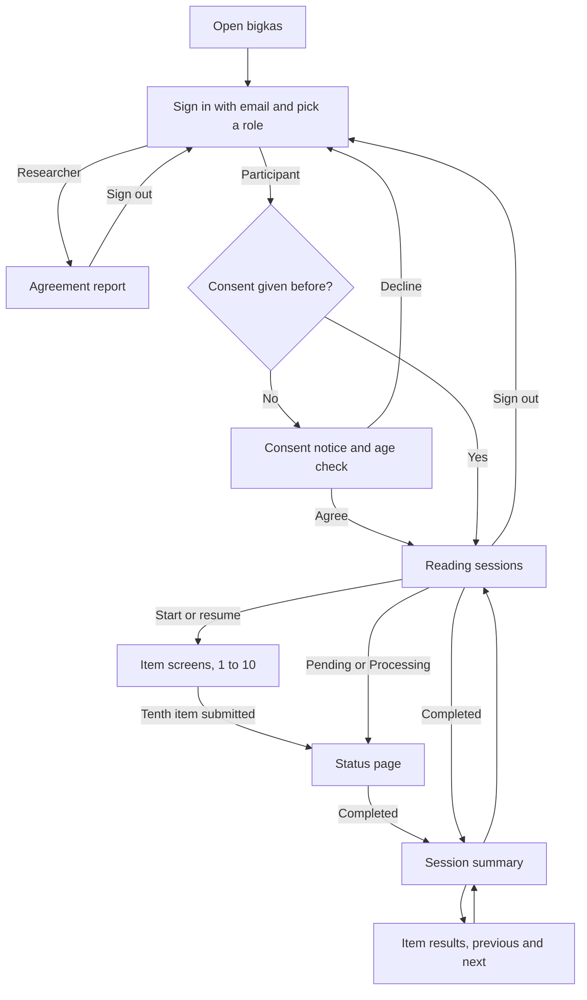
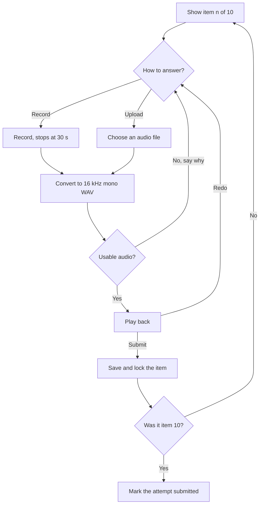
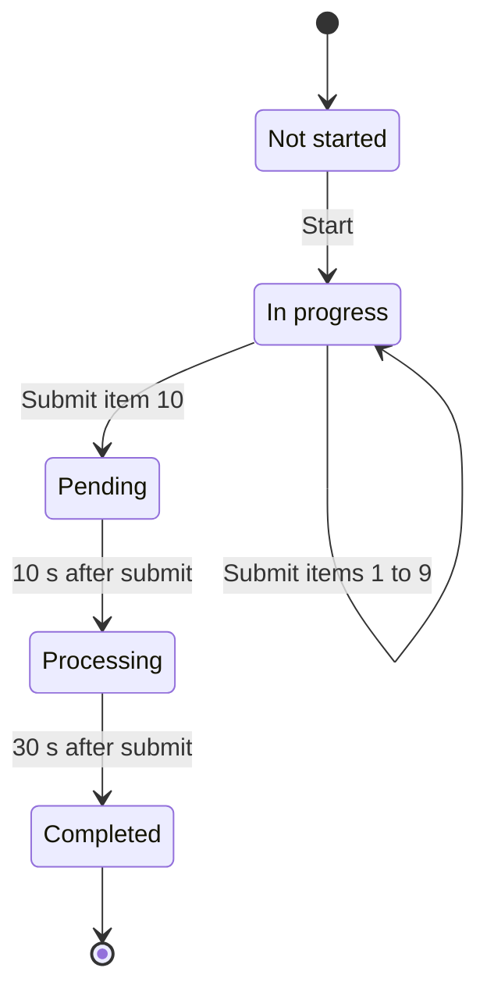
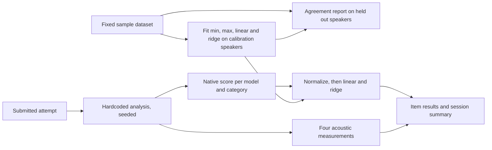

# bigkas web app flow

This is the planned flow. Nothing is built yet. Rules behind each step are in the [design](superpowers/specs/2026-11-26-bigkas-poc-design.md).

## 1. Whole app

Sign out is available on every signed in page, not only the two shown.

## 2. One item

## 3. Attempt status

## 4. Where the numbers come from

The recording is stored and played back, but it does not influence any number. Every results screen says so with a Simulated label.

## 5. Pages

| Page | Path | Who |
|---|---|---|
| Sign in | `/` | Everyone |
| Consent | `/consent` | Participant |
| Reading sessions | `/sessions` | Participant |
| Item recorder | `/attempts/[attemptId]/record` | Participant |
| Status or session summary | `/attempts/[attemptId]` | Participant |
| Item results | `/attempts/[attemptId]/items/[n]` | Participant |
| Agreement report | `/research` | Researcher |

Checks run in this order: signed in with the right role, then consent, then whether the attempt belongs to this profile. A failed first or second check leads to the missing step. A failed third check shows a short explanation with a link to the sessions page.

## 6. Defense walkthrough

1. Sign in as a participant and agree to the notice.
2. Start a session. Record a few items and upload one.
3. Submit the tenth item and watch Pending become Processing, then Completed.
4. Open the summary, then one item.
5. Sign out, sign in as a researcher, open the agreement report.
